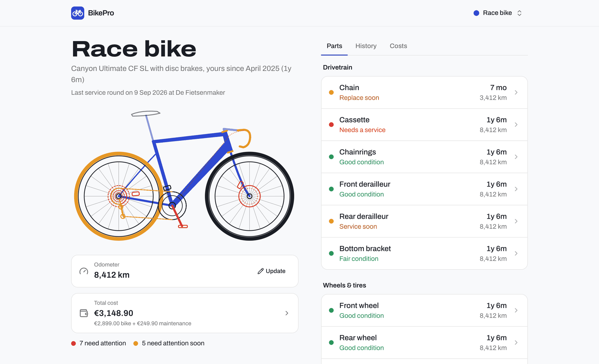
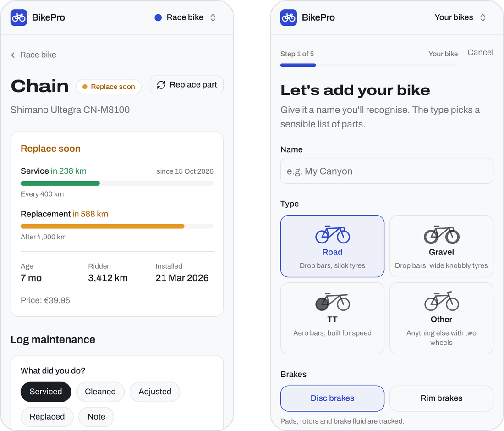
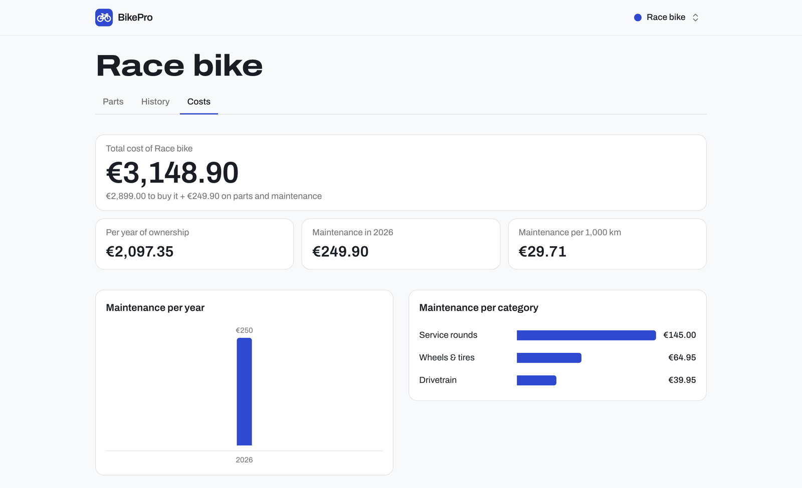

<div align="center">


# BikePro

**Know when your chain, tyres and brake pads need attention, before they let you down.**

A self-hosted maintenance tracker for your bikes: part wear, service history and costs,<br>
with kilometres synced from Strava.

[](https://github.com/HugooB/bikepro/actions/workflows/ci.yml)
[](LICENSE)
[](#quick-start)



</div>

## Why BikePro?

Every part of a bike wears at its own pace. A chain wants cleaning every few hundred kilometres and replacing after a few thousand. Tyres age even when you don't ride, and brake fluid needs a yearly bleed. Most riders keep this in their head, or don't keep it at all.

BikePro keeps it for you. Add your bike once and it tracks every part's age and kilometres, and tells you in plain words which ones are in good condition, which need a service, and which need replacing. It runs on your own server, keeps everything in a single SQLite file, and needs no subscription.

## Features

- **Every part at a glance.** An interactive drawing of your bike colours each part green, orange or red by condition. Tap a part to jump to it in the list.
- **Service and replacement intervals.** Each part has two clocks: how often it needs servicing, counted from the last service, and how long it lasts, counted from when it was fitted. Defaults come from published maintenance guides (sources in [`default-parts.ts`](src/lib/default-parts.ts)), and every value can be changed per part.
- **Full history.** Log cleaning, servicing and adjustments per part, record a shop visit covering many parts at once as a service round, and replace parts while keeping the old one's lifetime km, age and price.
- **Costs.** Purchase price, part prices and service bills add up to a total cost per bike, with cost per year of ownership, maintenance per 1,000 km, and charts per year and category.
- **Strava sync (optional).** Link each bike to its Strava bike and the odometer follows Strava's total automatically. BikePro reads only your bikes' total distance, never your rides.
- **Guided setup.** A five-step wizard picks sensible parts for road, gravel or TT bikes, with disc or rim brakes, and ages parts you've already replaced correctly.
- **Made for phones and desktops.** Large tap targets on phones, a two-column layout on desktop.
- **Your data stays yours.** Multiple accounts on one install, each seeing only their own bikes. Every user can download a JSON copy of their data.

<div align="center">

<br><br>

</div>

## Quick start

You need [Docker](https://docs.docker.com/get-docker/) with Docker Compose.

```bash
git clone https://github.com/HugooB/bikepro.git
cd bikepro
cp .env.example .env    # then set ADMIN_EMAIL and ADMIN_PASSWORD in .env
docker compose up -d --build
```

BikePro creates your admin account from `ADMIN_EMAIL` and `ADMIN_PASSWORD` on its first start. Open <http://localhost:3000>, sign in, and the wizard walks you through adding your first bike.

The database lives in the `bikepro-data` Docker volume, so it survives restarts and updates. `GET /api/health` reports whether the app and database are up.

## Configuration

All settings go in `.env`. Restart after changing them (`docker compose up -d`).

| Variable                                   | Default                 | What it does                                                                                                                                                                                                                      |
| ------------------------------------------ | ----------------------- | --------------------------------------------------------------------------------------------------------------------------------------------------------------------------------------------------------------------------------- |
| `APP_URL`                                  | `http://localhost:3000` | The address you open BikePro on. Set it to your `https://` address when running behind HTTPS: this keeps the sign-in cookie HTTPS-only and gives Strava the right callback address.                                               |
| `ADMIN_EMAIL`, `ADMIN_PASSWORD`            | empty                   | Create the admin account on start, so nobody else can claim a fresh install. The password is only used to create the account: changing it later has no effect. If an account with this email already exists, it becomes an admin. |
| `ADMIN_NAME`                               | `Admin`                 | The admin account's display name.                                                                                                                                                                                                 |
| `STRAVA_CLIENT_ID`, `STRAVA_CLIENT_SECRET` | empty                   | Turn on Strava sync. See [Strava](#strava).                                                                                                                                                                                       |
| `DATABASE_PATH`                            | `data/bikepro.db`       | Where the SQLite file is stored.                                                                                                                                                                                                  |

## Strava

Linked bikes take their kilometres from Strava's total for that bike. BikePro syncs when you open it, at most once an hour, or straight away with **Sync now** in Settings.

1. Create an API application at [strava.com/settings/api](https://www.strava.com/settings/api). Set **Authorization Callback Domain** to the host you run BikePro on, without `http://` or a port: `localhost` on your own machine, or for example `bikes.example.com`.
2. Copy its **Client ID** and **Client Secret** into `.env` as `STRAVA_CLIENT_ID` and `STRAVA_CLIENT_SECRET`, set `APP_URL`, and restart.
3. In BikePro, go to **Settings → Strava → Connect with Strava**, then choose which Strava bike belongs to each of your bikes. You can also link a bike while adding it.

If a bike's odometer differs from Strava's total when you link it, you choose: keep your reading and add new Strava kilometres on top, or switch to Strava's total. Strava tokens are stored encrypted with a key derived from `STRAVA_CLIENT_SECRET`; if you change the secret, connect Strava again.

## Running it on your own domain

To use BikePro away from home, put it behind a reverse proxy that handles HTTPS, and don't expose port 3000 directly. With [Caddy](https://caddyserver.com), which gets certificates by itself, the whole `Caddyfile` is:

```
bikes.example.com {
	reverse_proxy localhost:3000
}
```

Then set `APP_URL=https://bikes.example.com` in `.env`, restart, and use `bikes.example.com` as the Strava callback domain. nginx, Traefik or a Cloudflare Tunnel work the same way: terminate HTTPS and forward to port 3000.

## Updating and backups

**Update** to the latest version. Database migrations run automatically on start:

```bash
git pull
docker compose up -d --build
```

**Back up** the database while BikePro runs:

```bash
docker compose exec bikepro node -e "require('better-sqlite3')('/app/data/bikepro.db').backup('/app/data/backup.db').then(() => console.log('ok'))"
docker compose cp bikepro:/app/data/backup.db ./bikepro-backup.db
```

To restore, stop BikePro, copy the file back to `/app/data/bikepro.db` in the volume, and start it again. Each user can also download their own data as JSON under **Settings → Your data**.

## Accounts and security

- The admin account comes from `ADMIN_EMAIL` and `ADMIN_PASSWORD`. Without them, the first person to open BikePro creates an account and becomes the admin, so set them before BikePro can be reached by others.
- Registration is closed once the first account exists. The admin opens and closes it under **Settings → Admin**, for example to let family members sign up.
- Passwords are hashed with scrypt. Sessions are stored in the database, so signing out (or **Sign out everywhere** in Settings) ends them immediately. Unused sessions expire after 30 days.
- After 10 failed sign-ins for an account, further attempts are refused for 15 minutes.
- Every page is sent with a strict Content Security Policy and other security headers. HSTS is added when `APP_URL` is `https://`.
- Found a security problem? Please report it privately, as described in [SECURITY.md](SECURITY.md).

## Good to know

- Distances are in kilometres and amounts in euros; there's no setting for miles or other currencies yet.
- The interface is in English.
- BikePro shows each part's condition in the app. It doesn't send notifications or emails.
- Strava sync reads your bikes' totals only. It doesn't import rides, and there are no webhooks, so kilometres update when you open the app.

## Roadmap

Planned, roughly in this order:

- **First public release (v0.1.0):**
  - set the first admin account through environment variables, so no stranger can claim a fresh install
  - open and close registration from the app
  - security headers
- **Account management:**
  - change your password
  - an admin can reset a user's password, with a command-line fallback
  - delete your account
  - import a JSON export into another install
- **Miles and other currencies,** chosen per user.
- **More languages,** starting with Dutch.
- **Install it as an app** on your phone's home screen.

Ideas for later: a ready-made Docker image, automatic backups, notifications when a part needs attention, and more bike types such as MTB and city bikes. Suggestions are welcome as [feature requests](https://github.com/HugooB/bikepro/issues/new/choose).

## Contributing

Issues and pull requests are welcome. See [CONTRIBUTING.md](CONTRIBUTING.md) for the development setup, the checks CI runs and how to change the database. [docs/architecture.md](docs/architecture.md) explains how BikePro works inside. Please report security problems privately, as described in [SECURITY.md](SECURITY.md), and follow the [Code of Conduct](CODE_OF_CONDUCT.md).

**Built with** [Next.js](https://nextjs.org) 16 and React 19, [SQLite](https://sqlite.org) through [Drizzle ORM](https://orm.drizzle.team), [Tailwind CSS](https://tailwindcss.com) 4 and [Radix UI](https://www.radix-ui.com), with [zod](https://zod.dev) for validation and [Vitest](https://vitest.dev) for tests.

## License

[MIT](LICENSE) © Hugo Bijmans
